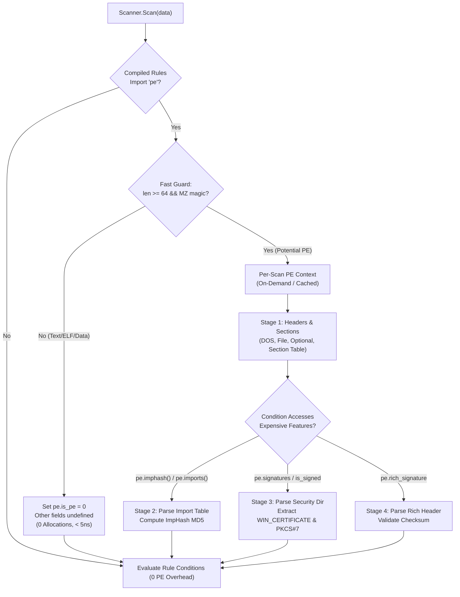

# RFC: Native Pure-Go `pe` Module & Standalone `go-pe` Engine

* **Author:** Caleb Walch (`cawalch`)
* **Status:** Approved / Proposed
* **Target:** `github.com/cawalch/go-yara` & `github.com/cawalch/go-pe`
* **Date:** 2026-10-25

---

## 1. Problem Statement & Motivation

In real-world threat hunting and detection engineering rule corpora (YARA Forge, Nextron Systems, InQuest), the `pe` module represents **~99% of total module usage** (7,394 references across 12,452 rules). More critically:
- **Over 60% of all PE usage** inspects Authenticode digital signatures (`pe.signatures` with 4,430 refs; `pe.number_of_signatures` with 1,607 refs).
- **Import hashing** (`pe.imphash` with 387 refs) serves as the industry standard for malware family clustering and pivoting.
- **Header & section heuristics** (`pe.sections`, `pe.exports`, `pe.rich_signature`, `pe.resources`) form the foundation of packer and anomaly detection rules.

### Current Engine State
- `go-yara` v0.8.0 introduced the foundational structured schema engine (`ModuleSchema`, `ModuleField`, `ModuleStruct`, `ModuleArray`, short-circuit bytecode iteration).
- However, `import "pe"` is currently rejected as an unsupported module (`compiler/condition_compiler.go:738`, `semantic/function_call.go:319`).
- Existing YARA engines in the ecosystem present major limitations:
  - `VirusTotal/go-yara`: Requires CGO and compiles libyara C code; fails in cross-compiled or containerless scratch environments.
  - `sansecio/yargo`: Pure Go, but completely lacks format modules (`pe`, `elf`, `macho`).
  - `YARA-X`: Reimplemented in Rust.
- **The Opportunity**: Delivering a native, pure-Go `pe` module makes `go-yara` the **first and only pure-Go engine capable of scanning the full YARA Forge corpus**.

---

## 2. Technical Evaluation of Native Go PE Parsers

Before designing our solution, we evaluated existing native Go PE solutions to assess feasibility, code quality, and maintainability:

| Parser | Status & Maintenance | Adversarial Hardening | Authenticode / Signatures | ImpHash | Memory Profile | Verdict |
| :--- | :--- | :--- | :--- | :--- | :--- | :--- |
| **`debug/pe`** (Go stdlib) | Maintained (Go team) | ❌ Panics/fails on corrupted headers | ❌ Unsupported | ❌ Unsupported | Low | **Unusable**: Strictly for benign Go/C toolchain outputs. |
| **`saferwall/pe`** | Stagnant (~5+ mos, unmerged PRs) | ⚠️ Fragile (scattered direct slicing) | ✅ Implemented | ✅ Implemented | ❌ Monolithic eager allocations | **High Liability**: Panic-prone, JSON-dump design, 15k+ LOC. |
| **`Velocidex/go-pe`** | Active (Mike Cohen) | ⚠️ Partial | ❌ Unsupported | ❌ Unsupported | Medium | **Specialized**: Built only for RSDS GUIDs, PDB, and versioninfo. |
| **`Codehardt/go-pefile`** | Abandoned | ⚠️ Low | ❌ Unsupported | ⚠️ Inefficient | ❌ Heavy Python structures | **Unusable**: Literal Python port. |

### Architectural Liabilities in `saferwall/pe`
1. **Ad-Hoc Direct Slicing & Repeated Panic Bugs**:
   `saferwall/pe` indexes raw byte slices directly (`data[offset : offset+size]`) without a centralized bounds-checked reader. As a result, it suffers from repeated slice bounds out-of-range panics when exposed to adversarial or malformed inputs (e.g., PR #115, PR #124, PR #91). In a scanner like `go-yara`, an uncaught panic terminates the entire scan.
2. **Monolithic Eager Allocation**:
   Designed as a backend malware sandbox report generator (serializing everything to JSON), it eagerly parses every data directory into large heap structures regardless of caller queries. A YARA rule checking `pe.number_of_sections > 5` creates hundreds of unnecessary allocations.
3. **Rotting Dependencies**:
   Relies on `github.com/edsrzf/mmap-go` (unmaintained for 9 years) with historical unmapping memory leak bugs.

**Conclusion**: Rather than inheriting 15,000+ lines of decaying third-party code, we will build a clean, modern, zero-panic, low-allocation Go PE engine (`go-pe`) designed as a standalone module (~2,500–3,200 LOC) and integrate it cleanly into `go-yara`.

---

## 3. High-Level Architecture & Integration



### 3.1 Core Architecture of `go-pe`
1. **Unified Safe Binary Reader (`SafeReader`)**:
   - Zero direct slicing. All reads flow through safe primitives: `ReadUint16()`, `ReadUint32()`, `ReadBytes(offset, len)`, `ReadASCIIZ(offset, maxLen)`.
   - Guaranteed **never to panic** on any input, truncated stream, or integer overflow.
2. **Zero-Allocation Lazy Architecture**:
   - Header and section parsing takes **< 1 microsecond and 0 heap allocations**.
   - Expensive tables (Imports, Exports, Signatures, Resources) are only parsed when explicitly queried.
3. **No Heavy Dependencies**:
   - Uses Go standard library + lightweight, hardened PKCS#7 parsing for Authenticode.
   - Built-in zero-copy `mmap` and `io.ReaderAt` support.

### 3.2 Integration into `go-yara`
1. **Engine Lifecycle Hook (`AutoParse`)**:
   - Add `AutoParse func(ctx ModuleContext) (ModuleValue, error)` to `compiler.Module`.
   - When a rule imports `pe`, `Scanner` automatically invokes `AutoParse` once per target file/buffer.
2. **Fast Non-PE Rejection**:
   - If `len(ctx.Data) < 64 || ctx.Data[0] != 'M' || ctx.Data[1] != 'Z'`, immediately return `is_pe = 0` with zero heap allocations.
3. **Per-Scan Caching & Memory Reuse**:
   - The parsed PE snapshot is cached on `Scanner` for the duration of a scan across all evaluating rules.
   - Reusable scanners reset the PE state between scans without memory reallocation.

---

## 4. `pe` Module Specification in `go-yara`

### 4.1 Schema Fields
```go
pe.is_pe                      // int (1 or 0)
pe.machine                    // int (pe.MACHINE_*)
pe.subsystem                  // int (pe.SUBSYSTEM_*)
pe.timestamp                  // int (Unix timestamp)
pe.characteristics            // int (bitmap)
pe.entry_point                // int (RVA)
pe.entry_point_raw            // int (file offset)
pe.image_base                 // int
pe.number_of_sections         // int
pe.number_of_signatures       // int
pe.is_signed                  // bool
pe.number_of_resources        // int
pe.number_of_version_infos    // int
pe.dll_name                   // string

pe.sections[i]:
  .name                       // string (e.g. ".text", ".data")
  .characteristics            // int
  .virtual_address            // int
  .virtual_size               // int
  .raw_data_offset            // int
  .raw_data_size              // int

pe.signatures[i]:
  .thumbprint                 // string (SHA-1/256 hex)
  .issuer                     // string (RFC 2253 / X.500 DN)
  .subject                    // string (RFC 2253 / X.500 DN)
  .version                    // int
  .algorithm                  // string
  .algorithm_oid              // string
  .serial                     // string (lowercase colon-separated hex)
  .not_before                 // int (Unix timestamp)
  .not_after                  // int (Unix timestamp)
  .verified                   // bool

pe.resources[i]:
  .offset, .length, .type, .id, .language, .type_string, .name_string, .language_string

pe.version_info               // dictionary: string -> string
pe.rich_signature             // struct: offset, length, key, raw_data, clear_data
```

### 4.2 Functions
- `pe.imphash()` -> `string` (normalized MD5 matching `pefile`/`libyara`)
- `pe.imports(dll_name, [func_or_ord])` -> `bool`
- `pe.exports(func_name_or_regex)` -> `bool`
- `pe.is_dll()` -> `bool`
- `pe.is_32bit()` / `pe.is_64bit()` -> `bool`
- `pe.section_index(name_or_rva)` -> `int`
- `pe.rva_to_offset(rva)` -> `int`
- `pe.calculate_checksum()` -> `int`

### 4.3 Compile-Time Constants
`MACHINE_*`, `SUBSYSTEM_*`, `SECTION_*`, `RESOURCE_TYPE_*` (folded at compile-time with 0 runtime evaluation cost).

---

## 5. Phased Delivery Roadmap

* **Phase 1: Standalone `go-pe` Core & `go-yara` Plumbing**
  - Implement `SafeReader`, DOS header, NT headers, Section table, RVA translation in `go-pe`.
  - Add `AutoParse` hook to `go-yara` modules.
  - Implement fast `MZ` prefilter guard (< 5ns, 0 allocs).
  - Expose `pe.is_pe`, `pe.machine`, `pe.subsystem`, `pe.number_of_sections`, `pe.sections`, and compile-time constants.
* **Phase 2: Imports, Exports & `imphash`**
  - Implement Import Directory table and Delayed Imports parsing.
  - Implement canonical `imphash` calculation matching `pefile` and `libyara`.
  - Expose `pe.imphash()`, `pe.imports(...)`, `pe.exports(...)`, and `pe.is_dll()`.
* **Phase 3: Authenticode & Digital Signatures (P0)**
  - Parse `IMAGE_DIRECTORY_ENTRY_SECURITY` and `WIN_CERTIFICATE`.
  - Implement PKCS#7 `SignedData` parser and X.509 cert extractor.
  - Expose `pe.signatures[...]`, `pe.number_of_signatures`, `pe.is_signed`, and `pe.signatures[i].valid_on(timestamp)`.
  - Implement Authenticode hash verification (`verified`).
* **Phase 4: Extended Artifacts**
  - Rich Header XOR decrypt and checksum verification.
  - Resource Directory tree traversal and `VS_VERSIONINFO` extraction.
* **Phase 5: Validation & Differential Fuzzing**
  - Full YARA Forge corpus test (12,452 rules).
  - Differential fuzzing against `libyara` on malformed binaries.
